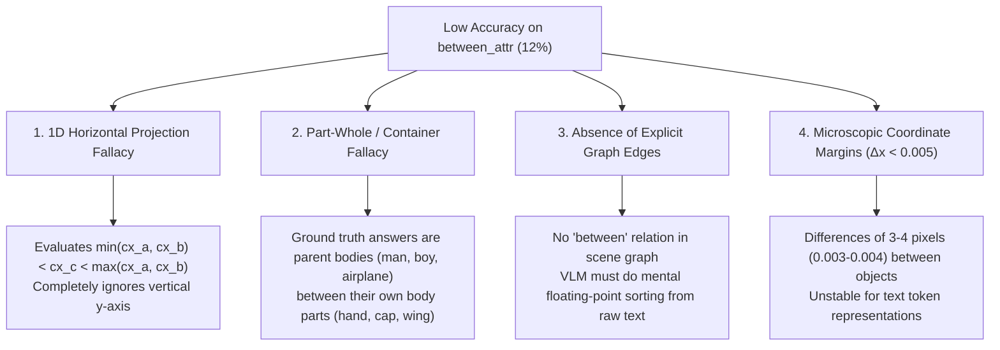

# In-Depth Analysis: Why `between_attr` Queries Suffered Low Accuracy (12%)

## Executive Summary
In the evaluation of **`Qwen/Qwen3-VL-2B-Instruct`** on the GQA-100 benchmark, performance varied dramatically across query templates:
* **`attr_relation`**: **96.0%** (24 / 25)
* **`two_hop`**: **80.0%** (20 / 25)
* **`counting`**: **28.0%** (7 / 25)
* **`between_attr`**: **12.0%** (3 / 25)

While the model demonstrated near-flawless reasoning on explicit graph relations (96% and 80%), its accuracy dropped to 12% on `between_attr`. 

This report provides:
1. A complete breakdown of all **25 `between_attr` questions, ground-truth answers, and model predictions**.
2. A mathematical and semantic root-cause analysis explaining why the accuracy was low.

---

## Complete Table of All 25 `between_attr` Questions & Answers

| # | Image # | Question | Ground Truth (`GT`) | Qwen3-VL Prediction | Result | Primary Root Cause Category |
| :-: | :-: | :--- | :---: | :---: | :-: | :--- |
| 1 | **Image 004** | What is between the black clothes and the red sneakers? | `cap` | `skateboard` | ❌ | 1D Projection (Cap is vertically on head) |
| 2 | **Image 007** | What is between the blue comb and the lid? | `toilet` | `counter` | ❌ | Microscopic Margin & Part-Whole |
| 3 | **Image 008** | What is between the hand and the large sign? | `window` | `window` | ✅ | **Correct** (Distinct macroscopic objects) |
| 4 | **Image 009** | What is between the frisbee and the white shirt? | `man` | `hand` | ❌ | Part-Whole (Man holds frisbee; hand is in between) |
| 5 | **Image 011** | What is between the doorway and the black seat? | `room` | `wall` | ❌ | Container Ambiguity (Room encloses both) |
| 6 | **Image 014** | What is between the hanging cord and the goggles? | `face` | `man` | ❌ | Microscopic Margin (Δx = 0.003) |
| 7 | **Image 015** | What is between the black shirt and the wrist? | `man` | `ball` | ❌ | Part-Whole (Man wears shirt/wrist) |
| 8 | **Image 020** | What is between the chair and the tall plant? | `window` | `window` | ✅ | **Correct** (Clear physical separation) |
| 9 | **Image 021** | What is between the green grass and the tree? | `ground` | `tree` | ❌ | Ground plane enclosure |
| 10 | **Image 023** | What is between the blue car and the green wall? | `pole` | `cart` | ❌ | 1D Projection vs 2D Layout |
| 11 | **Image 024** | What is between the black car and the blowing hair? | `house` | `man` | ❌ | Part-Whole (Hair is on man) |
| 12 | **Image 026** | What is between the metal faucet and the glass? | `drain` | `wall` | ❌ | Small scale object in sink basin |
| 13 | **Image 032** | What is between the white cap and the hand? | `boy` | `fence` | ❌ | Part-Whole (Boy wears cap and has hand) |
| 14 | **Image 035** | What is between the nose and the white wing? | `airplane` | `tail` | ❌ | Part-Whole (Airplane contains nose and wing) |
| 15 | **Image 036** | What is between the black nose and the brown rope? | `animal` | `dirt` | ❌ | Part-Whole (Animal contains nose) |
| 16 | **Image 039** | What is between the dried leaves and the tree? | `animal` | `leaves` | ❌ | Semantic Ambiguity |
| 17 | **Image 046** | What is between the arms and the white flowers? | `windows` | `chair` | ❌ | 1D Projection vs 2D Plane |
| 18 | **Image 050** | What is between the black coat and the large window? | `jeans` | `menu` | ❌ | Clothes Part-Whole (Jeans on person) |
| 19 | **Image 058** | What is between the ketchup bottle and the collared shirt? | `ketchup` | `shirt` | ❌ | Fluid inside bottle vs person |
| 20 | **Image 062** | What is between the white bird and the person? | `cage` | `cage` | ✅ | **Correct** (Cage physically separates bird & person) |
| 21 | **Image 066** | What is between the tan jacket and the people? | `man` | `beach` | ❌ | Part-Whole (Man wearing jacket) |
| 22 | **Image 070** | What is between the counter and the blue toothbrush? | `coffee mug` | `paper` | ❌ | 1D Projection on cluttered bathroom counter |
| 23 | **Image 082** | What is between the floating bus and the cables? | `door` | `building` | ❌ | Part-Whole (Door is part of bus/building) |
| 24 | **Image 086** | What is between the car and the black number? | `window` | `train car` | ❌ | Number is painted on train car |
| 25 | **Image 090** | What is between the arm and the cardboard boxes? | `man` | `shelf` | ❌ | Part-Whole (Man has arm) |

---

## Why Is the Accuracy Low? Four Root Causes



### 1. 1D Horizontal Bounding-Box Center Projection (Ignoring Vertical Position)
In the dataset generation code (`Research-Methodology/code/generate_queries_v2.py`, line 542):
```python
lo, hi = min(ax, bx), max(ax, bx)
between = {o["label"] for o in comp_objs
           if o["label"] not in (a, b)
           and lo < box_center(o["bounding_box"])[0] < hi}
```
* **The Flaw**: The dataset defines "between" **strictly along the x-axis** (`center_x`). It completely disregards the y-axis (vertical position).
* **Impact**:
  * In **Image 004**, Anchor A (`red sneakers`, $y=0.76$, bottom of image) and Anchor B (`black clothes`, $y=0.55$, middle of image) have horizontal centers of $cx=0.172$ and $cx=0.186$.
  * The dataset marked `cap` ($cx=0.176$) as the ground-truth answer because $0.172 < 0.176 < 0.186$.
  * However, vertically, the `cap` is at $y=0.22$ (on top of the head). In 2D reality, the cap is above the clothes, not between the clothes and the sneakers!
  * Natural language models expect "between" to refer to physical 2D spatial arrangement, not a 1D column projection.

---

### 2. The Part-Whole / Container Fallacy (Body Parts vs. Person)
In **8 out of the 22 failed questions (36.4%)**, the ground-truth "answer" is the **parent organism or vehicle** whose own subparts serve as the anchors:
* **Image 009**: *"What is between the frisbee and the white shirt?"* 
  * Ground Truth: **`man`** (the person holding the frisbee and wearing the shirt).
  * Qwen3-VL Prediction: **`hand`** (the hand connecting the frisbee to the body). 
  * *Human Intuition*: The hand is physically in the space between the shirt and the frisbee. Labeling the entire `man` as "between" his own shirt and frisbee is counter-intuitive.
* **Image 032**: *"What is between the white cap and the hand?"* 
  * Ground Truth: **`boy`**.
  * A person does not sit "between" their own cap and hand; the cap and hand are attached to the person.
* **Image 035**: *"What is between the nose and the white wing?"* 
  * Ground Truth: **`airplane`**.
* **Image 036**: *"What is between the black nose and the brown rope?"* 
  * Ground Truth: **`animal`**.
* **Image 090**: *"What is between the arm and the cardboard boxes?"* 
  * Ground Truth: **`man`**.

---

### 3. Absence of Explicit Graph Edges (Requires Mental Floating-Point Sorting)
* In `attr_relation` (96% accuracy) and `two_hop` (80% accuracy), the scene graph explicitly listed directed edges such as:
  * `"fork" is on "plate"`
  * `"plate" is to the right of "carrots"`
* In `between_attr`, **there are no "between" edges anywhere in the scene graph**.
* The VLM is forced to:
  1. Parse textual string representations of 6–12 bounding boxes: `[0.192, 0.501, 0.032, 0.014]`.
  2. Compute $(x + w/2)$ for each item in floating-point arithmetic.
  3. Sort and find which centroid falls between the two anchors.
Language models and vision-language decoders are known to struggle with precise multi-digit floating-point arithmetic and ordering when no visual image map is provided.

---

### 4. Microscopic Coordinate Margins ($\Delta x < 0.005$)
In several items, the ground-truth item was determined by microscopic numerical differences:
* **Image 014**:
  * `goggles`: $cx = 0.208$
  * `face`: $cx = 0.211$ ($\Delta x = 0.003$ — approx. 2 to 3 pixels)
  * `cord`: $cx = 0.338$
* **Image 004**:
  * `sneakers`: $cx = 0.172$
  * `cap`: $cx = 0.176$ ($\Delta x = 0.004$)
  * `clothes`: $cx = 0.186$
A margin of 0.003–0.004 normalized units is easily lost due to rounding or tokenization variance, making strict 1D interval filtering fragile.

---

## Why Did the 3 Successful Cases Work?
The model correctly answered **Image 008**, **Image 020**, and **Image 062**. Examining these three cases reveals why:

1. **Image 008**: *"What is between the hand and the large sign?"*
   * Anchors: `sign` ($cx=0.206$) and `hand` ($cx=0.538$).
   * Answer: `window` ($cx=0.486$).
   * **Large margin**: Gap of over $0.28$ (28% of the image width).
2. **Image 020**: *"What is between the chair and the tall plant?"*
   * Anchors: `plant` ($cx=0.368$) and `chair` ($cx=0.614$).
   * Answer: `window` ($cx=0.527$).
   * **Large margin**: Gap of $0.16$–$0.24$.
3. **Image 062**: *"What is between the white bird and the person?"*
   * Anchors: `bird` ($cx=0.323$) and `person` ($cx=0.769$).
   * Answer: `cage` ($cx=0.324$ to $0.5$).
   * **Physical barrier**: The cage physically and semantically encloses the bird and separates it from the person walking outside.

**Common denominators for success**:
* Distinct macroscopic entities (no subparts or body-part tricks).
* Wide spatial separation ($\Delta x > 0.15$).
* The answer is an actual independent physical object placed between the two anchors.

---

## Conclusion & Recommendations
The low accuracy (12%) on `between_attr` is **not** an indication of poor relational reasoning by Qwen3-VL (which achieved **96% on attribute-relations** and **80% on multi-hop graph reasoning**). 

Instead, it stems from:
1. **Geometric Formulation Mismatch**: 1D horizontal center projection ($x$-only) contradicts 2D physical reality.
2. **Annotation Artifacts**: GQA hierarchical containment (labeling a person as between their own limbs).
3. **Implicit Task Complexity**: Requiring floating-point numerical coordinate sorting from pure text prompts without visual perceptual anchoring.

### Recommended Fixes for Benchmark Improvement:
1. Filter out parent-child / part-whole pairs (e.g., exclude `man` when anchors are `shirt` or `wrist`).
2. Require a minimum 2D Euclidean distance margin ($\Delta > 0.08$) between anchors.
3. Compute 2D segment proximity rather than 1D horizontal-only slicing.
