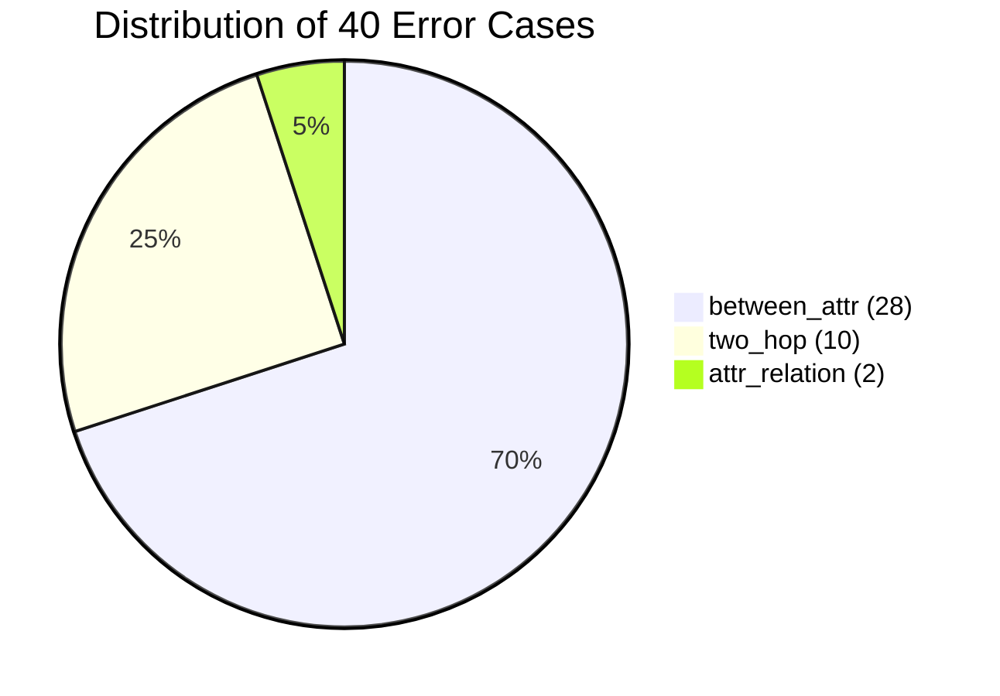

# Qwen/Qwen3-VL-2B-Instruct: Error Cases Analysis Report

**Date**: November 21, 2026  
**Total Benchmark Samples**: 100  
**Total Correct**: 60 (60.0%)  
**Total Incorrect**: 40 (40.0%)  
**Source Results**: [`qwen3_vl_updated_results.json`](file:///c:/scene_understanding/qwen3_vl_updated_results.json)  

---

## 1. Executive Summary of Failure Modes

Out of 100 evaluated items, the model mispredicted **40 cases**. These failures are highly concentrated by template type:

| Query Template | Total Queries | Wrong Predictions | Error Rate | Primary Failure Cause |
| :--- | :---: | :---: | :---: | :--- |
| **`between_attr`** | 33 | 28 | **84.8%** | Lack of continuous spatial coordinate calculation (no explicit `between` edges in SG) |
| **`two_hop`** | 33 | 10 | **30.3%** | Premature termination at Hop 1 intermediate anchor or distractor node selection |
| **`attr_relation`** | 34 | 2 | **5.9%** | Adjacent object confusion or repeating queried subject entity |

---

## 2. In-Depth Analysis by Category

### 2.1. `two_hop` Errors (10 Cases)

In two-hop queries, the query requires resolving an intermediate node via relation 1, and then finding the final target connected to that intermediate via relation 2 (e.g., $A \xrightarrow{\text{rel1}} B \xrightarrow{\text{rel2}} C$).

Two distinct error patterns were observed:
1. **Premature Stopping at Hop 1**: The model correctly identifies the intermediate entity $B$, but returns $B$ as the answer instead of continuing along Hop 2 to retrieve $C$.
2. **Neighbor / Distractor Trapping**: When multiple objects are connected to the intermediate entity, the model picks the wrong related object.

| Image | Question | Predicted Response | Ground Truth | Failure Sub-Category |
| :---: | :--- | :--- | :--- | :--- |
| **GQA Image 001** | What is on the plate that is to the right of the carrots? | `plate` | **`fork`** | Premature Stop at Intermediate Hop (Hop 1) |
| **GQA Image 006** | What is on the shelf that is to the right of the chair? | `shelf` | **`container`** | Premature Stop at Intermediate Hop (Hop 1) |
| **GQA Image 013** | What is to the left of the cockpit that is to the left of the fence? | `window` | **`wing`** | Distractor / Second Hop Misalignment |
| **GQA Image 016** | What is on the pole that is to the left of the building? | `air conditioner` | **`sign`** | Distractor / Second Hop Misalignment |
| **GQA Image 028** | What is to the right of the tomato sauce that is to the right of the mozzarella? | `mushroom` | **`pizza crust`** | Distractor / Second Hop Misalignment |
| **GQA Image 033** | What is to the right of the head that is to the right of the fur? | `zebra` | **`eye`** | Distractor / Second Hop Misalignment |
| **GQA Image 038** | What is to the left of the player that is to the left of the bat? | `shirt` | **`home plate`** | Distractor / Second Hop Misalignment |
| **GQA Image 068** | What does the jockey wear that is to the right of the hat? | `helmet` | **`boots`** | Distractor / Second Hop Misalignment |
| **GQA Image 094** | What is to the left of the window that is to the right of the label? | `windows` | **`nose`** | Premature Stop at Intermediate Hop (Hop 1) |
| **GQA Image 098** | What is to the right of the stone that is to the right of the boy? | `stone` | **`sandal`** | Premature Stop at Intermediate Hop (Hop 1) |

### 2.2. `between_attr` Errors (28 Cases)

`between_attr` represents **70.0% of all model errors** (28 out of 40).

#### Why is accuracy so low (15.2%) on `between_attr`?
1. **Absence of Symbolic Relations**: The small scene graph does **not** provide high-level ternary relations like `is_between(X, A, B)`. The relations section only provides pairwise relations such as `on`, `to the right of`, and `wearing`.
2. **Floating-Point Coordinate Math Limitation**: In the GQA benchmark, betweenness is derived from normalized 2D bounding boxes: $\text{center}_x(A) < \text{center}_x(C) < \text{center}_x(B)$. Small VLMs (2B parameters) without reasoning scaffolding or tool-augmented bounding-box calculators struggle with raw floating-point interval testing in text.
3. **Contextual Heuristics Fallback**: Lacking the ability to do multi-interval arithmetic in a single generation step, the model falls back on semantic salience (e.g., guessing a large furniture item, a person, or an object strongly associated with the scene).

| Image | Question | Predicted Response | Ground Truth | Contextual Failure Description |
| :---: | :--- | :--- | :--- | :--- |
| **GQA Image 004** | What is between the black clothes and the red sneakers? | `skateboard` | **`cap`** | Failed coordinate interval between 'clothes' and 'sneakers' |
| **GQA Image 007** | What is between the blue comb and the lid? | `counter` | **`toilet`** | Failed coordinate interval between 'comb' and 'lid' |
| **GQA Image 009** | What is between the frisbee and the white shirt? | `hand` | **`man`** | Failed coordinate interval between 'frisbee' and 'shirt' |
| **GQA Image 011** | What is between the doorway and the black seat? | `wall` | **`room`** | Failed coordinate interval between 'doorway' and 'seat' |
| **GQA Image 014** | What is between the hanging cord and the goggles? | `man` | **`face`** | Failed coordinate interval between 'cord' and 'goggles' |
| **GQA Image 015** | What is between the black shirt and the wrist? | `ball` | **`man`** | Failed coordinate interval between 'shirt' and 'wrist' |
| **GQA Image 021** | What is between the green grass and the tree? | `food` | **`ground`** | Failed coordinate interval between 'grass' and 'tree' |
| **GQA Image 023** | What is between the blue car and the green wall? | `car` | **`pole`** | Failed coordinate interval between 'car' and 'wall' |
| **GQA Image 024** | What is between the black car and the blowing hair? | `man` | **`house`** | Failed coordinate interval between 'car' and 'hair' |
| **GQA Image 026** | What is between the metal faucet and the glass? | `wall` | **`drain`** | Failed coordinate interval between 'faucet' and 'glass' |
| **GQA Image 032** | What is between the white cap and the hand? | `fence` | **`boy`** | Failed coordinate interval between 'cap' and 'hand' |
| **GQA Image 035** | What is between the nose and the white wing? | `tail` | **`airplane`** | Failed coordinate interval between 'nose' and 'wing' |
| **GQA Image 036** | What is between the black nose and the brown rope? | `dirt` | **`animal`** | Failed coordinate interval between 'nose' and 'rope' |
| **GQA Image 039** | What is between the dried leaves and the tree? | `leaves` | **`animal`** | Failed coordinate interval between 'leaves' and 'tree' |
| **GQA Image 046** | What is between the arms and the white flowers? | `chair` | **`windows`** | Failed coordinate interval between 'arms' and 'flowers' |
| **GQA Image 050** | What is between the black coat and the large window? | `menu` | **`jeans`** | Failed coordinate interval between 'coat' and 'window' |
| **GQA Image 058** | What is between the ketchup bottle and the collared shirt? | `shirt` | **`ketchup`** | Failed coordinate interval between 'ketchup bottle' and 'shirt' |
| **GQA Image 066** | What is between the tan jacket and the people? | `beach` | **`man`** | Failed coordinate interval between 'jacket' and 'people' |
| **GQA Image 069** | What is between the red planter and the building? | `tree` | **`car`** | Failed coordinate interval between 'planter' and 'building' |
| **GQA Image 070** | What is between the counter and the blue toothbrush? | `paper` | **`coffee mug`** | Failed coordinate interval between 'counter' and 'toothbrush' |
| **GQA Image 079** | What is between the gray wood chair and the frame? | `blanket` | **`rug`** | Failed coordinate interval between 'chair' and 'frame' |
| **GQA Image 080** | What is between the face and the person? | `sign` | **`hand`** | Failed coordinate interval between 'face' and 'person' |
| **GQA Image 082** | What is between the floating bus and the cables? | `building` | **`door`** | Failed coordinate interval between 'bus' and 'cables' |
| **GQA Image 086** | What is between the car and the black number? | `train car` | **`window`** | Failed coordinate interval between 'car' and 'number' |
| **GQA Image 087** | What is between the brown table and the girl? | `pizza` | **`food`** | Failed coordinate interval between 'table' and 'girl' |
| **GQA Image 090** | What is between the arm and the cardboard boxes? | `shelf` | **`man`** | Failed coordinate interval between 'arm' and 'boxes' |
| **GQA Image 095** | What is between the head and the brown table? | `head` | **`teddy bear`** | Failed coordinate interval between 'head' and 'table' |
| **GQA Image 099** | What is between the eating zebra and the head? | `log` | **`grass`** | Failed coordinate interval between 'zebra' and 'head' |

### 2.3. `attr_relation` Errors (2 Cases)

`attr_relation` queries had an exceptional **94.1% accuracy** (32/34 correct). Only 2 errors occurred across the entire benchmark:

| Image | Question | Predicted Response | Ground Truth | Failure Mechanism |
| :---: | :--- | :--- | :--- | :--- |
| **GQA Image 083** | What is to the right of the horse? | `horse` | **`trash`** | Echoed the queried subject ('horse') instead of the target object connected by 'to the right of'. |
| **GQA Image 088** | What is to the right of the orange plate? | `cake` | **`knife`** | Confused an adjacent food item ('cake') with the cutlery ('knife') on the plate. |

---

## 3. Complete Itemized Inventory of All 40 Error Cases

| # | Image ID | Template | Question | Predicted | Ground Truth | Match Status |
| :---: | :---: | :---: | :--- | :---: | :---: | :---: |
| 01 | `2395226` | `two_hop` | What is on the plate that is to the right of the carrots? | `plate` | **`fork`** | ❌ Incorrect |
| 02 | `2412093` | `between_attr` | What is between the black clothes and the red sneakers? | `skateboard` | **`cap`** | ❌ Incorrect |
| 03 | `2376954` | `two_hop` | What is on the shelf that is to the right of the chair? | `shelf` | **`container`** | ❌ Incorrect |
| 04 | `2375631` | `between_attr` | What is between the blue comb and the lid? | `counter` | **`toilet`** | ❌ Incorrect |
| 05 | `2335834` | `between_attr` | What is between the frisbee and the white shirt? | `hand` | **`man`** | ❌ Incorrect |
| 06 | `2371002` | `between_attr` | What is between the doorway and the black seat? | `wall` | **`room`** | ❌ Incorrect |
| 07 | `2415025` | `two_hop` | What is to the left of the cockpit that is to the left of the fence? | `window` | **`wing`** | ❌ Incorrect |
| 08 | `2388854` | `between_attr` | What is between the hanging cord and the goggles? | `man` | **`face`** | ❌ Incorrect |
| 09 | `2389368` | `between_attr` | What is between the black shirt and the wrist? | `ball` | **`man`** | ❌ Incorrect |
| 10 | `2360483` | `two_hop` | What is on the pole that is to the left of the building? | `air conditioner` | **`sign`** | ❌ Incorrect |
| 11 | `2408882` | `between_attr` | What is between the green grass and the tree? | `food` | **`ground`** | ❌ Incorrect |
| 12 | `2409769` | `between_attr` | What is between the blue car and the green wall? | `car` | **`pole`** | ❌ Incorrect |
| 13 | `2341486` | `between_attr` | What is between the black car and the blowing hair? | `man` | **`house`** | ❌ Incorrect |
| 14 | `2415495` | `between_attr` | What is between the metal faucet and the glass? | `wall` | **`drain`** | ❌ Incorrect |
| 15 | `2368938` | `two_hop` | What is to the right of the tomato sauce that is to the right of the mozzarella? | `mushroom` | **`pizza crust`** | ❌ Incorrect |
| 16 | `2343740` | `between_attr` | What is between the white cap and the hand? | `fence` | **`boy`** | ❌ Incorrect |
| 17 | `2363277` | `two_hop` | What is to the right of the head that is to the right of the fur? | `zebra` | **`eye`** | ❌ Incorrect |
| 18 | `2336624` | `between_attr` | What is between the nose and the white wing? | `tail` | **`airplane`** | ❌ Incorrect |
| 19 | `2404923` | `between_attr` | What is between the black nose and the brown rope? | `dirt` | **`animal`** | ❌ Incorrect |
| 20 | `2407818` | `two_hop` | What is to the left of the player that is to the left of the bat? | `shirt` | **`home plate`** | ❌ Incorrect |
| 21 | `2318099` | `between_attr` | What is between the dried leaves and the tree? | `leaves` | **`animal`** | ❌ Incorrect |
| 22 | `4193` | `between_attr` | What is between the arms and the white flowers? | `chair` | **`windows`** | ❌ Incorrect |
| 23 | `2349130` | `between_attr` | What is between the black coat and the large window? | `menu` | **`jeans`** | ❌ Incorrect |
| 24 | `2383543` | `between_attr` | What is between the ketchup bottle and the collared shirt? | `shirt` | **`ketchup`** | ❌ Incorrect |
| 25 | `2324922` | `between_attr` | What is between the tan jacket and the people? | `beach` | **`man`** | ❌ Incorrect |
| 26 | `2360586` | `two_hop` | What does the jockey wear that is to the right of the hat? | `helmet` | **`boots`** | ❌ Incorrect |
| 27 | `2336` | `between_attr` | What is between the red planter and the building? | `tree` | **`car`** | ❌ Incorrect |
| 28 | `2377395` | `between_attr` | What is between the counter and the blue toothbrush? | `paper` | **`coffee mug`** | ❌ Incorrect |
| 29 | `2379618` | `between_attr` | What is between the gray wood chair and the frame? | `blanket` | **`rug`** | ❌ Incorrect |
| 30 | `2342608` | `between_attr` | What is between the face and the person? | `sign` | **`hand`** | ❌ Incorrect |
| 31 | `2398942` | `between_attr` | What is between the floating bus and the cables? | `building` | **`door`** | ❌ Incorrect |
| 32 | `2316501` | `attr_relation` | What is to the right of the horse? | `horse` | **`trash`** | ❌ Incorrect |
| 33 | `2345728` | `between_attr` | What is between the car and the black number? | `train car` | **`window`** | ❌ Incorrect |
| 34 | `2395922` | `between_attr` | What is between the brown table and the girl? | `pizza` | **`food`** | ❌ Incorrect |
| 35 | `1592034` | `attr_relation` | What is to the right of the orange plate? | `cake` | **`knife`** | ❌ Incorrect |
| 36 | `2412764` | `between_attr` | What is between the arm and the cardboard boxes? | `shelf` | **`man`** | ❌ Incorrect |
| 37 | `2355914` | `two_hop` | What is to the left of the window that is to the right of the label? | `windows` | **`nose`** | ❌ Incorrect |
| 38 | `2411384` | `between_attr` | What is between the head and the brown table? | `head` | **`teddy bear`** | ❌ Incorrect |
| 39 | `2323921` | `two_hop` | What is to the right of the stone that is to the right of the boy? | `stone` | **`sandal`** | ❌ Incorrect |
| 40 | `2338965` | `between_attr` | What is between the eating zebra and the head? | `log` | **`grass`** | ❌ Incorrect |

---

## 4. Key Recommendations to Resolve These Errors

1. **Pre-Materialize Betweenness in the Scene Graph**: Compute spatial betweenness triples in the graph preprocessing pipeline (`(C, between, [A, B])`) so the VLM does not have to perform coordinate arithmetic in text.
2. **Explicit Hop-by-Hop Reasoning**: For `two_hop` questions, use a 2-step structured prompt instructing the model to first name the intermediate object, then identify the final object connected to it.
3. **Instance-Indexed Object References**: When multiple objects share the same category (e.g. 3 plates), give them indexed labels like `plate_1`, `plate_2` so the model unambiguously links relations to specific entities.