# Comparative Analysis Report: Scene Graph Prompting Strategies on Qwen3-VL-2B-Instruct

**Evaluation Date**: November 22, 2026  
**Model**: `Qwen/Qwen3-VL-2B-Instruct` (Hugging Face)  
**Hardware Accelerator**: Kaggle GPU (Tesla T4, FP16)  
**Benchmark Scope**: 100 GQA Images with Small Scene Graphs (Labels & Attributes + Directed Relations, without Bounding Box coordinate noise)  
**Categories Evaluated**: 
- `attr_relation` (34 questions)
- `two_hop` (33 questions)
- `spatial_conjunction` (33 questions)

---

## 1. Executive Summary & Benchmark Scoreboard

We conducted an exhaustive 100-sample comparative evaluation between **Direct Scene Graph Prompting** and **Universal Zero-Shot Chain-of-Thought (CoT)**.

```mermaid
xychart-beta
    title "Overall and Category Accuracy Comparison (%)"
    x-axis ["Overall", "Attr Relation", "Spatial Conjunction", "Two Hop"]
    y-axis "Accuracy (%)" 0 --> 100
    bar [79.0, 85.3, 84.8, 66.7]
    bar [51.0, 67.6, 45.5, 39.4]
```

### Overall Benchmark Comparison Table

| Metric | Direct Answering (Primary Strategy) | Zero-Shot CoT (1024 Token Budget) | Impact / Delta |
| :--- | :---: | :---: | :---: |
| **Overall Accuracy** | **79.00% (79 / 100)** | **51.00% (51 / 100)** | **+28.00%** |
| **Exact Match Rate** | **77.00% (77 / 100)** | **30.00% (30 / 100)** | **+47.00%** |
| **Total Benchmark Time** | **17.3 seconds** | **4,022.5 seconds (~67.0 min)** | **232x Faster** |
| **Average Latency / Sample** | **0.17 seconds** | **40.22 seconds** | Direct avoids token bloat |

---

## 2. Category Breakdown Comparison

| Question Category | Total Samples | Direct Prompting (Correct / Acc) | Direct Exact Match | Zero-Shot CoT (Correct / Acc) | CoT Exact Match |
| :--- | :---: | :---: | :---: | :---: | :---: |
| **`attr_relation`** | 34 | **29 / 34 (85.29%)** | 29 (85.29%) | 23 / 34 (67.65%) | 15 (44.12%) |
| **`spatial_conjunction`** | 33 | **28 / 33 (84.85%)** | 26 (78.79%) | 15 / 33 (45.45%) | 8 (24.24%) |
| **`two_hop`** | 33 | **22 / 33 (66.67%)** | 22 (66.67%) | 13 / 33 (39.39%) | 7 (21.21%) |
| **Total** | **100** | **79 / 100 (79.00%)** | **77 (77.00%)** | **51 / 100 (51.00%)** | **30 (30.00%)** |

---

## 3. The Core Research Insight: The Two-Hop Tradeoff & The Token Truncation Paradox

Our empirical findings establish a critical architectural insight regarding how compact (2B parameter) Vision-Language Models handle structured graph reasoning:

### A. The Chain-of-Thought (CoT) Reality: Capable Reasoning, Crippled by Token Truncation
1. **100% Precision on Completed Chains**:
   - In all 30 samples where the 2B model concluded its step-by-step reasoning naturally before hitting the token ceiling, it achieved **30 / 30 (100.0% Accuracy and 100.0% Exact Match)**.
2. **Hidden Grounding in 93.9% of "Failures"**:
   - Out of the 49 samples officially marked incorrect under CoT, **46 of them (93.88%) actually derived and wrote the exact ground-truth entity in their intermediate reasoning text**.
3. **The Token Truncation Trap (100% of CoT Errors)**:
   - **All 49 errors (100%) were caused by hitting the 1,024-token budget mid-sentence**. 
   - Without an explicit brevity constraint, small 2B models lack internal self-termination regularization. When given open-ended instructions to *"Reason step-by-step"*, the model engages in conversational over-deliberation (*"Wait — let's re-verify", "Could there be an ambiguity?", "On the other hand..."*), running completely out of tokens before reaching the closing `Final Answer: <answer>` template line.

### B. The Direct Prompting Reality: High Precision & Speed, But Vulnerable to Multi-Hop Compositionality
1. **Fast, Noise-Free Retrieval**:
   - Direct prompting directly requests the target entity without reasoning tokens. This achieves **79.00% accuracy** and **77.00% exact matches** in just **17.3 seconds (0.17s/sample)**, completely circumventing token truncation.
2. **Superior Spatial Conjunction Handling (84.85%)**:
   - On dual-anchor spatial intersection queries (`spatial_conjunction`), Direct Prompting successfully resolved **28 out of 33 items (84.85%)**. Removing bounding boxes allowed the clean topological edges to act as immediate key-value lookups.
3. **The Direct Prompting Disadvantage: Two-Hop Traversal (66.67%)**:
   - While Direct Prompting dominates 1-hop (`attr_relation`: 85.3%) and conjunctions (`spatial_conjunction`: 84.8%), its primary weakness is **`two_hop` compositionality** ($A \xrightarrow{R_1} B \xrightarrow{R_2} C$).
   - Lacking the intermediate scratchpad of CoT, the model often experiences "premature stopping," predicting the intermediate hop ($B$) instead of traversing through to the final target entity ($C$).
   - *Example (Image 006)*: Question asks *"What is on the shelf that is to the right of the chair?"*
     - Direct Prompting output: `shelf` (stopped at hop 1).
     - Ground Truth: `container` (terminal target at hop 2).
     - CoT reasoning output: Correctly identified `shelf` as the intermediate node and deduced `container`, but truncated before finalizing.

---

## 5. Model-Generated Scene Graphs: The Spatial Relation Breakthrough

### A. The Baseline Deficit (25.0% Accuracy)
When Direct Prompting was applied to scene graphs automatically generated by the fine-tuned VLM (`qwen3-direct-generated-sg-eval`), accuracy collapsed from 79.0% to **25.0% (17.0% exact)**.
- **Root Cause**: The prompt focused on part-whole relations (`airplane -has-> fuselage`, `person wearing shirt`).
- Out of 820 relations, **only 16.8% (138)** were directional spatial relations, with heavy bias toward `wearing` (107), `has` (91), and `on` (75).
- Downstream spatial queries (e.g. *"What is to the left of the cockpit?"*) lacked corresponding edges, causing the model to guess arbitrarily (`fuselage` instead of `propeller`).

### B. The Spatial-Focused Scene Graph Re-Engineering
To fix this, we redesigned the generation prompt using **Few-Shot + Embedded Spatial CoT**:
1. **Decoupled Structural Sub-Components**: Primary entities are decomposed into distinct child nodes (`cockpit`, `left propeller`, `fuselage`) with 2-4 visual attributes.
2. **Directional Spatial Focus**: Explicitly prioritizes horizontal/vertical alignment (`to the left of`, `to the right of`, `above`, `below`, `in front of`, `behind`).
3. **Distribution Shift**:
   - Directional spatial triples surged from **16.8% (138)** to **58.8% (718 triples)** across the 100 benchmark images.
   - Non-spatial clutter (`wearing`, `has`) dropped to 0%.
4. **End-to-End Image 002 Verification**:
   - Query: *"What is to the left of the cockpit?"* (GT: `propeller`)
   - Previous SGG output: `fuselage` (FAILED).
   - New Spatial SGG output: **`left propeller` (CORRECT, 0.31s latency)**.

---

## 6. Final Recommendation & Implementation Strategy

1. **Production / Primary Strategy**: **Direct Scene Graph Prompting**
   - Adopt Direct Prompting as the main deployment pipeline for high throughput (0.17s latency), zero token truncation risk, and superior accuracy.
2. **Research & Academic Reporting**:
   - Feature the CoT vs. Direct and Ground Truth vs. Model-Generated tradeoffs side-by-side in the research thesis. Emphasize that compact 2B VLMs possess the latent relational capacity to solve multi-hop graph questions, but directional spatial edge extraction is mandatory for downstream spatial QA.

---
*Generated and verified from Kaggle GPU runs `qwen3-direct-nobbox-benchmark`, `qwen3-full-100-cot-benchmark`, `qwen3-direct-generated-sg-eval`, and `qwen3-spatial-sgg-100`.*
