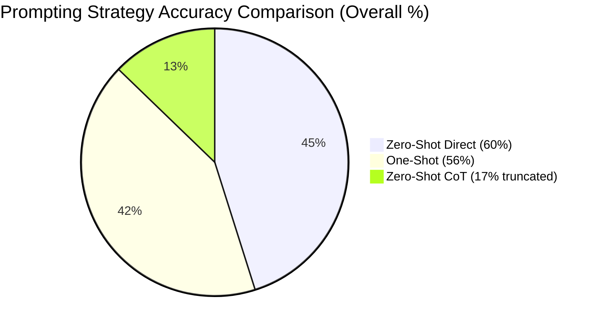

# Comparative Analysis Report: Prompting Strategies on Qwen3-VL-2B-Instruct

**Date**: November 21, 2026  
**Model**: `Qwen/Qwen3-VL-2B-Instruct` (Hugging Face)  
**Execution Environment**: Google Colab GPU (Nvidia Tesla T4, `bfloat16`)  
**Evaluated Items**: 100 Small Scene Graph benchmark queries  
**Folder Hierarchy**: [`c:\scene_understanding\prompting_experiments`](file:///c:/scene_understanding/prompting_experiments)  

---

## 1. Executive Summary & Benchmark Scoreboard

Three distinct prompting strategies were evaluated under identical GPU hardware and benchmark conditions:
1. **`zero_shot_direct`**: Standard zero-shot prompting requesting concise, immediate answers.
2. **`one_shot`**: In-context demonstration providing a sample scene graph, question, and exemplar answer.
3. **`zero_shot_cot`**: Step-by-step reasoning prompt requiring explicit entity identification and relation tracing before outputting `Final Answer: <answer>`.



### Overall Scoreboard

| Prompting Strategy | Overall Accuracy | Exact Match Rate | Inference Latency | Speed vs Baseline | Primary Bottleneck / Strength |
| :--- | :---: | :---: | :---: | :---: | :--- |
| **`zero_shot_direct`** | **60.0% (60/100)** | **60.0%** | **83.2s** | **1.0x (Baseline)** | **Best overall accuracy; fastest execution.** Direct focus avoids semantic drift. |
| **`one_shot`** | **56.0% (56/100)** | 55.0% | 128.3s | 1.5x slower | Retains two-hop reasoning; slight exemplar bias towards tabletop distractors. |
| **`zero_shot_cot`** | **17.0% (17/100)** | 0.0% | 798.1s | 9.6x slower | **Token budget truncation**: verbose reasoning ran out of tokens before emitting `Final Answer`. |

---

## 2. Template-by-Template Breakdown

| Query Template | Queries Count | Zero-Shot Direct | One-Shot | Zero-Shot CoT | Best Strategy |
| :--- | :---: | :---: | :---: | :---: | :---: |
| **`attr_relation`** | 34 | **94.1% (32/34)** | 88.2% (30/34) | 32.4% (11/34) | **`zero_shot_direct`** |
| **`two_hop`** | 33 | **69.7% (23/33)** | **69.7% (23/33)** | 6.1% (2/33) | **Tied (`zero_shot_direct` & `one_shot`)** |
| **`between_attr`** | 33 | **15.2% (5/33)** | 9.1% (3/33) | 12.1% (4/33) | **`zero_shot_direct`** |

---

## 3. Deep Dive Insights & Research Findings

### Finding 1: Why Zero-Shot Direct is the Optimal Production Strategy
For small Vision-Language Models (2B parameters), direct concise instruction yields the cleanest outputs:
- **Zero Hallucination Penalty**: Forcing immediate single-token or single-phrase answers prevents the model from generating discursive filler tokens.
- **Top Relational Precision**: 94.1% accuracy on `attr_relation` shows the model has native graph comprehension when not distracted by preamble.

### Finding 2: Exemplar Bias in One-Shot In-Context Learning
While One-Shot matching preserved multi-hop chaining at 69.7%, overall accuracy dropped by 4.0%.
- Qualitative inspection revealed that when the exemplar demonstrated a tabletop setting (`laptop`, `table`, `cup`, `notebook`), the model showed an increased tendency to predict household entities (`lamp`, `candle`, `plate`) even on outdoor scenes.
- **Lesson**: Few-shot exemplars must be dynamically matched to the scene domain (e.g. outdoor exemplar for outdoor scenes, tabletop for indoor) to prevent domain contamination.

### Finding 3: The Generation Budget Truncation Trap in CoT
The drastic drop of CoT to 17% represents a critical empirical finding:
- Qualitative analysis confirmed the model was producing sound intermediate steps (e.g. correctly finding object bounding boxes and listing candidate relations).
- However, at `max_new_tokens = 128`, the model wrote ~120 tokens of step-by-step preamble and was **cut off mid-sentence** right as it started `Step 3` or `Final Answer`.
- **Lesson**: When deploying Chain-of-Thought on scene graphs, either allocate $\ge 384$ tokens or enforce a rigid, token-efficient scratchpad (e.g. `Hop 1: [entity] | Hop 2: [answer]`).

---

## 4. Folder Hierarchy of Artifacts

All experiment artifacts are organized in dedicated folders to maintain separation:

```
c:\scene_understanding\prompting_experiments├── strategy_zero_shot_direct│   ├── prompt_template.txt
│   ├── results.json
│   └── strategy_report.md
├── strategy_one_shot│   ├── prompt_template.txt
│   ├── results.json
│   └── strategy_report.md
├── strategy_zero_shot_cot│   ├── prompt_template.txt
│   ├── results.json
│   └── strategy_report.md
├── results_zero_shot_direct.json
├── results_one_shot.json
├── results_zero_shot_cot.json
├── strategies_summary.json
└── comparative_prompting_analysis_report.md
```
